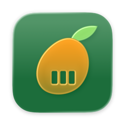
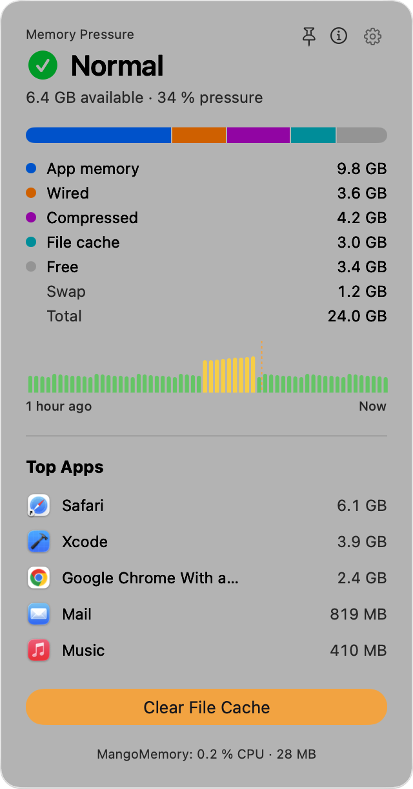
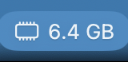
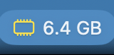
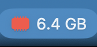
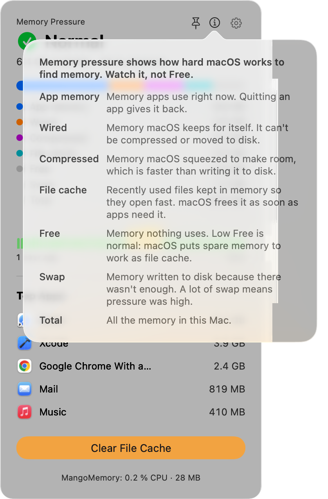
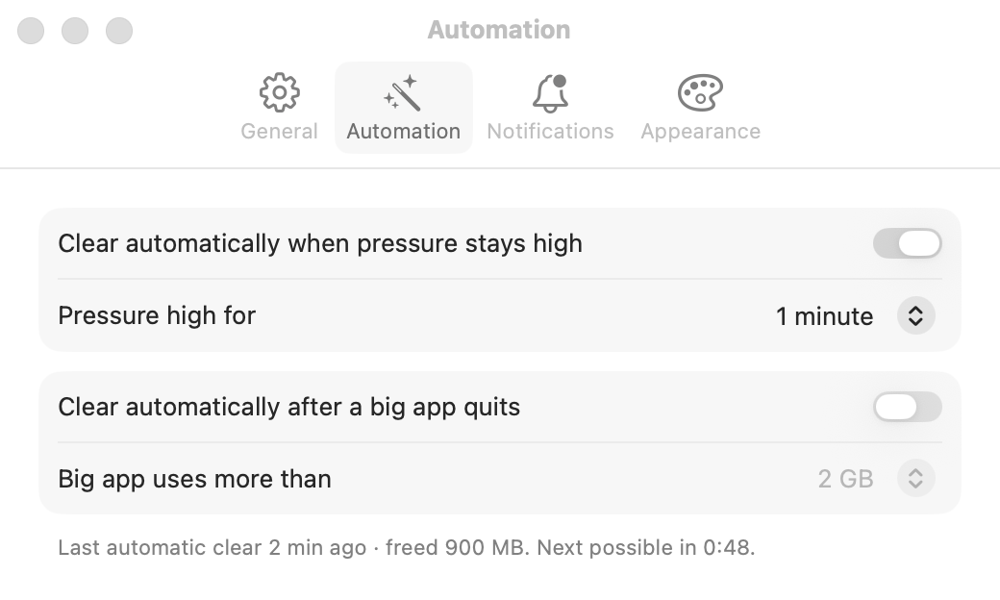

<p align="center">
  
</p>

<h1 align="center">MangoMemory</h1>

<p align="center">
  <b>An honest menu bar memory app for macOS.</b><br>
  See memory pressure at a glance, find the app using your RAM, quit it, or clear the file cache in one click.
</p>

<p align="center">
  macOS 26 Tahoe or later · Apple silicon · SwiftUI · No accounts, no tracking, no upsell
</p>

<p align="center">
  <picture>
    <source media="(prefers-color-scheme: dark)" srcset="docs/images/window-dark.png">
    
  </picture>
</p>

---

## Why another memory app?

Most memory cleaners show you **free memory**, which is the wrong number. macOS
uses spare RAM on purpose, as file cache, so "free" is usually low on a
healthy Mac. Then they sell you a "deep clean" that just shuffles memory around.

MangoMemory shows what actually matters:

- **Memory pressure first.** Normal, High, or Critical: how hard macOS is
  working to find memory. That's the number Activity Monitor uses too.
- **What is using it.** The five apps using the most memory, helper processes
  included (Safari's web pages count toward Safari), with Quit right there.
- **A real clear.** Clear File Cache runs Apple's own `/usr/sbin/purge` and
  then tells you what it actually freed, including "Nothing much to clear"
  when that's the truth.

## Features

### In the menu bar
- A memory chip glyph that's **plain at Normal, yellow at High, and filled red
  at Critical**, so it differs by shape, not only by color.
- Next to it: **available memory**, **pressure %**, or nothing. Regular or large text.
- **⌃⌥M** opens and closes the window from any app. You can change the shortcut.

| Normal | High | Critical |
| :---: | :---: | :---: |
|  |  |  |

### In the window
- **Pressure** level, available memory, and pressure %.
- **Breakdown:** App memory, Wired, Compressed, File cache, Free, Swap, and
  Total, as a bar and as rows. The numbers match Activity Monitor and `vm_stat`.
- **The last hour** of pressure, one bar per minute in its level's color,
  with a dashed line at every clear.
- **Top Apps:** hover a row for **Quit**. If an app doesn't quit within five
  seconds, it offers **Force Quit**, and asks first.
- **Clear File Cache**, then a result line like *"Freed 1.2 GB · pressure 62 % → 48 %"*.
- **ⓘ** explains every number in plain words, including why low Free is normal.
- **📌 Keep Window Open** turns the drop-down into a floating window on every Space.
- A footer with what **MangoMemory itself** uses (about 20 MB and 0.0 % CPU when idle).
- **Keyboard only:** ↑ ↓ select an app, Return quits it, ⌘K clears, Escape closes.

<p align="center">
  <picture>
    <source media="(prefers-color-scheme: dark)" srcset="docs/images/window-help-popover-dark.png">
    
  </picture>
</p>

### On its own
- **Clear automatically when pressure stays high**, after 30 seconds,
  1 minute, or 5 minutes.
- **Clear automatically after a big app quits**, for apps over 1, 2, or 4 GB.
- **One quiet notification** when pressure turns Critical (or High, if you
  choose), naming the top app, with a **Quit** button. Then none for 30 minutes.
- Every clear, automatic or not, shares one 3-minute cooldown, so it never
  clears over and over.

<p align="center">
  <picture>
    <source media="(prefers-color-scheme: dark)" srcset="docs/images/settings-automation-dark.png">
    
  </picture>
</p>

### Settings
- **General:** refresh interval, what the menu bar shows, text size, Open at
  login, the window shortcut, and **Sync settings with iCloud**, which keeps
  every setting the same on all your Macs through iCloud Drive.
- **Automation**, **Notifications**, and **Appearance** (accent color). In
  Multicolor, the accent is mango orange.

## Install

MangoMemory ships outside the App Store, signed with Developer ID and
notarized by Apple, so it opens without warnings.

1. Unzip `MangoMemory-<version>.zip` and move **MangoMemory.app** to Applications.
2. Open it. It lives in the menu bar; there's no Dock icon.
3. To clear the file cache, click **Allow Helper…** in the window, then turn
   MangoMemory on in **System Settings › General › Login Items & Extensions**. macOS asks
   once per Mac.

### What the helper is, and why it needs admin rights

`purge` only runs as root. MangoMemory installs a tiny launchd helper through
Apple's `SMAppService`, which you approve in System Settings. The helper:

- does **one thing**: runs `/usr/sbin/purge`, and takes no arguments
  from anyone;
- accepts requests **only from MangoMemory signed by our team**
  (`SJR7785KA2`), enforced with a code-signing requirement on its XPC connection;
- can be turned off at any time in Login Items.

Everything else (reading memory, quitting apps, notifications) runs as you.
MangoMemory never touches the network, except iCloud Drive for settings sync
if you leave it on.

## Build from source

You need macOS 26, Xcode 26 (Swift 6.2 or later), and an Apple Development
certificate (Xcode › Settings › Accounts) for the helper to accept the build.
There's no Xcode project: it's a Swift package plus a build script.

```bash
git clone https://github.com/Mangocorporation/MangoMemory.git
cd MangoMemory
./build.sh --open          # builds, signs, installs ~/Applications/MangoMemory.app, opens it
```

| Command | What it does |
| --- | --- |
| `./build.sh [--debug] [--open]` | Build, sign, and install to `~/Applications` |
| `swift test --scratch-path ~/Library/Developer/MangoMemory/test-build` | Unit tests for the rules and math in `MangoMemoryKit` |
| `tools/selftest.sh` | Runs the app's real code against fakes and prints PASS or FAIL per check |
| `tools/snap.sh` | Light and dark screenshots of every window state and Settings tab in `/tmp/MangoMemory-shots/` |
| `tools/grid-lint.sh` | Checks that spacing sits on the 4 pt grid |
| `tools/release.sh [--check]` | Developer ID build, notarized and stapled, in `dist/` (see [docs/RELEASE.md](docs/RELEASE.md)) |

Test runs (`APP_STORE` set) use their own settings and a sample memory
source, so they **never quit a real app, never run `purge`, never post a
notification, and never touch iCloud Drive**.

## How it works

```text
Sources/
  MangoMemoryKit/      pure logic, unit tested: memory math, Top Apps ranking,
                       auto-clear and alert rules, pressure history, settings sync file
  MangoMemory/         the app (SwiftUI MenuBarExtra, Settings, default MainActor)
    Memory/            kernel readings, quitting apps, the helper client, automation, sync
    Views/             the window, Top Apps, the chart, Settings tabs
    UI/                design tokens, the global shortcut, the pinned window
  MangoMemoryHelper/   the root launchd daemon: one XPC call that runs purge
```

- **Memory numbers** come from `host_statistics64`, `sysctl`
  (`kern.memorystatus_vm_pressure_level`, `vm.swapusage`), and
  `proc_pid_rusage` footprints, the same sources as Activity Monitor. The
  self-test checks them against `vm_stat` and `sysctl` within 3 %.
- **Every outside effect sits behind a seam** with a real and a fake
  adapter: memory source, app quitter, cache clearer, notifier.
- **A closed window costs nothing.** The menu bar reads one value; the window
  reads its data only while it's open, and live numbers never animate (an
  earlier version spent 24 % CPU redrawing a hidden window; see
  [docs/FIXLOG.md](docs/FIXLOG.md)).

More: [ARCHITECTURE.md](ARCHITECTURE.md) · design tokens in
[design/DESIGN-SYSTEM.md](design/DESIGN-SYSTEM.md) · the words the app uses in
[docs/GLOSSARY.md](docs/GLOSSARY.md) · every feature as a user story in
[docs/STORIES.md](docs/STORIES.md).

## Privacy

MangoMemory has no analytics, no accounts, and no servers. It reads memory
statistics and the names and memory use of running apps, on your Mac only.
Settings sync, if on, writes one small JSON file to *your* iCloud Drive
(`iCloud Drive › MangoMemory › Settings.json`).

## FAQ

**Free memory is almost zero. Is that bad?**
No. macOS fills spare memory with file cache so files open faster, and hands
it back the moment an app needs it. Watch **pressure**, not Free.

**Does clearing the file cache make my Mac faster?**
Usually not by much, and MangoMemory says so. It helps right before something
memory-hungry, or when pressure stays high. The cache refills as you use files.

**Why isn't MangoMemory on the Mac App Store?**
App Store apps must run in the sandbox, which forbids the root helper that
runs `purge` and limits looking at other apps' memory. We'd rather ship the
real thing.

**How do I remove it completely?**
Turn the helper off in System Settings › General › Login Items & Extensions, quit
MangoMemory (gear › Quit MangoMemory, or ⌘Q in the window), and move it to
the Trash.
